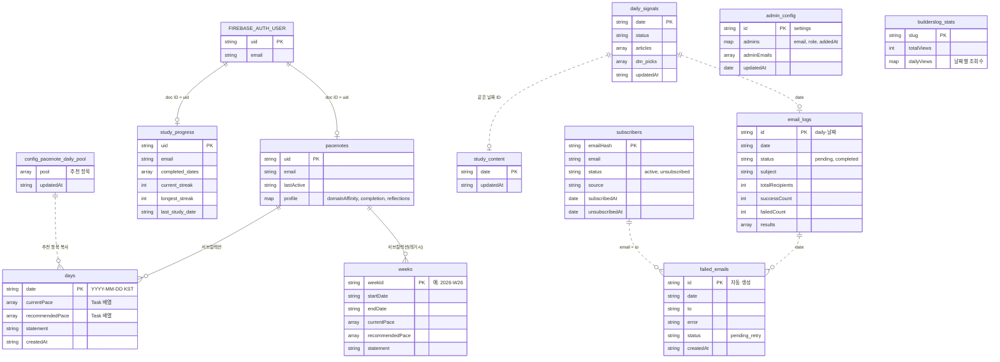
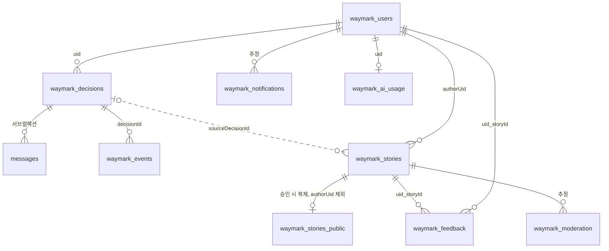

# 데이터 모델 ERD (Data Model ERD)

> PriSincera의 Firestore 컬렉션과 그 관계를 한 장으로 조망하는 문서. 필드 형상의 계약은 [데이터 계약 v2](../data_contract_v2.md), Waymark 필드 설계는 [Waymark 시스템 아키텍처 §3](../waymark/system_architecture.md)가 정본이다.

## Revision History

| Version | Date | Description | Impact Area |
| :--- | :--- | :--- | :--- |
| v1.0 | 2026-11-04 | 저장소에 ERD가 없어 코드·문서에서 최초 복원 | 전체 컬렉션 |

---

## 1. 이 문서를 읽는 법

- **복원 근거**: 코드의 Firestore 읽기·쓰기 지점, `firestore.rules`, 데이터 계약 문서. **운영 DB는 조회하지 않았다.** 코드에 없는 과거 필드가 실제 문서에 남아 있을 수 있다.
- **필드 범위**: 주요 필드만 싣는다. 전체 필드 목록이 아니다.
- **관계의 성격**: Firestore에는 외래키가 없어 참조 무결성을 DB가 보장하지 않는다. 아래 관계는 모두 코드가 지키는 논리적 관계다.
- **선 표기**: 실선은 문서 ID나 서브컬렉션으로 연결된 관계, 점선은 필드 값으로만 이어지는 관계다.

## 2. 운영 중인 서비스 ERD

`admin_config`와 `builderslog_stats`는 다른 컬렉션과 연결되지 않는다. `subscribers`도 회원 계정과 연결되지 않으며, 이메일 해시를 문서 ID로 쓴다.

### 2-1. 컬렉션 일람

| 컬렉션 | 문서 ID | 용도 | 쓰는 곳 | 클라이언트 직접 접근 |
| :--- | :--- | :--- | :--- | :--- |
| `pacenotes` | `uid` | 사용자별 PaceNote 루트·프로필 | `pacenote-api.mjs` | 차단(기본 규칙) |
| `pacenotes/{uid}/days` | `YYYY-MM-DD` | 일자별 궤도·회고 | `pacenote-api.mjs` | 차단(기본 규칙) |
| `pacenotes/{uid}/weeks` | ISO 주차 | 전환 이전 주 단위 데이터(레거시) | 없음(읽기 전용 보존) | 차단(기본 규칙) |
| `config/pacenote_daily_pool` | 고정 | PaceNote 추천 풀 | `admin-api.mjs`, 파이프라인 | 차단(기본 규칙) |
| `study_progress` | `uid` | 학습 완료일·스트릭 | `study-api.mjs` | 본인만 읽기·쓰기 |
| `study_content` | `YYYY-MM-DD` | 일자별 학습 콘텐츠 | 파이프라인, `admin-api.mjs` | 공개 읽기, 쓰기 차단 |
| `daily_signals` | `YYYY-MM-DD` | 일자별 시그널 | 파이프라인, `admin-api.mjs` | 차단 |
| `subscribers` | 이메일 해시 | 뉴스레터 구독자 | `pipeline/src/lib/subscribers.mjs` | 차단 |
| `email_logs` | `daily-YYYY-MM-DD` | 발송 이력·중복 발송 방지 락 | `MailService.mjs` | 차단 |
| `failed_emails` | 자동 생성 | 발송 실패 내역 | `MailService.mjs` | 차단(기본 규칙) |
| `admin_config` | `settings` | 관리자 목록·역할 | `admin-api.mjs` | 차단 |
| `builderslog_stats` | 글 slug | 조회수 집계 | `server.mjs` | 차단(기본 규칙) |

서버의 Admin SDK는 Security Rules를 우회한다. "차단"은 클라이언트 SDK에 대한 규칙이다. "기본 규칙"은 `firestore.rules`에 전용 규칙이 없어 전체 차단 규칙이 적용된다는 뜻이다.

### 2-2. 내장 타입 `Task`

`days`와 `weeks`의 `currentPace`, `recommendedPace`는 별도 컬렉션이 아니라 문서 안의 배열이다. 필드는 `id`, `title`, `category`, `color`, `completed`, `completedAt`이며 정본은 [데이터 계약 v2 §2.1](../data_contract_v2.md)이다.

### 2-3. Firestore 밖의 데이터

- **사용자 계정**: Firebase Auth가 보관한다. `uid`는 Auth에서 발급된다.
- **일일 피드**: GCS `daily/{date}.json`에도 저장된다. 피드 형상은 [데이터 계약 v2 §1](../data_contract_v2.md)을 따른다.

## 3. Waymark ERD (설계, 미구현)

서버 구현이 없다. `waymark_*` 컬렉션은 [waymarkModel.mjs](../../src/data/waymarkModel.mjs)와 [firestore.rules](../../firestore.rules)에만 정의되어 있고, `WaymarkApp.jsx`에는 API나 DB 호출이 없다. 구현되면 이 절을 갱신한다.

`waymark_notifications`와 `waymark_moderation`의 관계는 컬렉션 이름과 용도로 추정했다. 현재 설계 문서에 필드가 적혀 있지 않다.

## 4. 알려진 불일치·부채

| 항목 | 현황 | 영향 |
| :--- | :--- | :--- |
| Waymark 설계 불일치 | [system_architecture §3·§8](../waymark/system_architecture.md)은 `decisions`, `decisionEvents` 이름과 클라이언트 접근을 전제한다. 모델 파일과 rules는 `waymark_*` 이름과 서버 경유만 허용한다. | 구현 전에 정본을 정해야 한다. |
| `failed_emails` 재시도 미구현 | 코드 주석은 "재시도 큐"라고 하지만, 기록만 하고 읽는 코드가 없다. | 실패 메일이 자동으로 재발송되지 않는다. |
| 컬렉션 이름 분산 | `pacenotes`, `config`, `builderslog_stats`는 `COLLECTIONS` 상수에 없고 문자열로 직접 쓰인다. | 이름 변경이나 전수 조사 시 누락될 수 있다. |

## 5. 갱신 규칙

컬렉션을 추가·개명·삭제하거나 컬렉션 간 참조를 바꾸는 변경은 이 문서를 함께 갱신한다. 새 컬렉션을 추가할 때는 `firestore.rules`의 규칙 필요 여부도 함께 확인한다.

## 관련 문서

- [전체 아키텍처 개요](architecture_overview.md)
- [인증·권한 아키텍처](authentication_architecture.md)
- [데이터 계약 v2](../data_contract_v2.md)
- [Waymark 시스템 아키텍처](../waymark/system_architecture.md)
